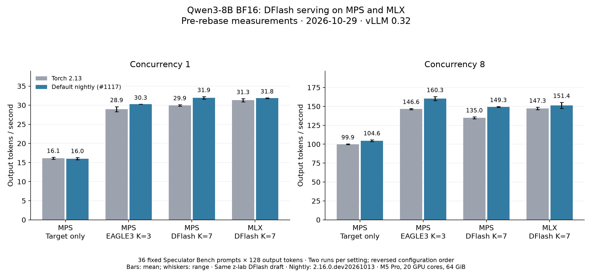

# MPS DFlash evidence

Benchmarks were measured on **2026-10-29**, with vLLM 0.32.0+cpu, on the DFlash patch in `measured-source.patch` applied to `e51f6e8755821e4684f544101783f8c545c711fb`. They predate the vLLM 0.33 rebase. Current code was revalidated for correctness on **2026-11-05** at `e5ddbf7ab049fc82068a0ffc34ae789de9842479`; its throughput has not been remeasured.



Mean output tokens/s across two fresh runs; C=8 is aggregate throughput. Whiskers in the figure show the observed range.

| Path | Torch 2.13 C=1 / C=8 | Nightly C=1 / C=8 |
|---|---:|---:|
| MPS target only | 16.11 / 99.94 | 16.01 / 104.65 |
| MPS EAGLE3 K=3 | 28.95 / 146.55 | 30.27 / 160.32 |
| MPS DFlash K=7 | 29.93 / 134.96 | 31.93 / 149.29 |
| MLX DFlash K=7 | 31.31 / 147.32 | 31.84 / 151.37 |

## Workload

Same saved 36-prompt sample as [EAGLE3 PR #1179](https://github.com/vllm-project/vllm-metal/pull/1179), built from [RedHatAI/speculator_benchmarks](https://huggingface.co/datasets/RedHatAI/speculator_benchmarks): four prompts per category, seed 1234, cap 1024 input tokens, actual lengths 11–789. Raw completions, identical input-token IDs, 128 greedy output tokens and ignored EOS. Eight excluded warmups per concurrency, two configuration sweeps in reverse order. All **1,152 timed requests** completed with zero failures or preemptions.

Qwen3-8B BF16 target. Both DFlash backends use the same z-lab Qwen3-8B-DFlash-b16 checkpoint at K=7; EAGLE3 uses RedHatAI's Qwen3-8B draft at K=3 with local argmax. Exact checkpoint revisions, serving settings, versions, individual run measurements, latency and acceptance metrics are in [benchmark.json](benchmark.json).

M5 Pro, 20 GPU cores, 64 GiB, macOS 27.0.1; MLX 0.32.4. Torch 2.13 is compared with 2.16.0.dev20261013, the full runtime upgrade from [#1117](https://github.com/vllm-project/vllm-metal/pull/1117), which is now the default. MPS CPU fallback was disabled. The benchmark client was fixed across all server arms.

MPS servers used asynchronous scheduling and a 3 GiB KV budget; MLX used synchronous scheduling and a 1,365-block scheduler limit. All used max model length 2,048, maximum sequences 8, prefill budget 512, and disabled prefix caching.

## Current code validation

[validation.json](validation.json) records the November 5 checks on vLLM 0.33.0+cpu and default nightly Torch: **6,397 passed / 16 skipped** in the non-slow suite; **259 passed / 2 optional Omni skips** in the focused MPS suite; Ruff and mypy passed.

Fresh native and target-only comparisons use matching checkpoints and input token IDs, 12 prompts × 32 output tokens at B=1/8, chunked prefill and prefix-cache reuse. All comparisons have **zero FAIL**. `TOP_K_MATCH` is mutual top-five membership at the first divergence, not full-sequence equality.

```bash
PYTORCH_ENABLE_MPS_FALLBACK=0 python -m pytest tests/ .github/scripts/test_parity.py -m 'not slow' -q
PYTORCH_ENABLE_MPS_FALLBACK=0 python -m pytest tests/test_mps_backend.py tests/test_mps_attention.py -q
ruff check .
ruff format --check .
mypy vllm_metal
```

The figure is also available as [PDF](comparison.pdf). Plot source: [plot.py](plot.py). This evidence branch is separate from the PR's code changes.
