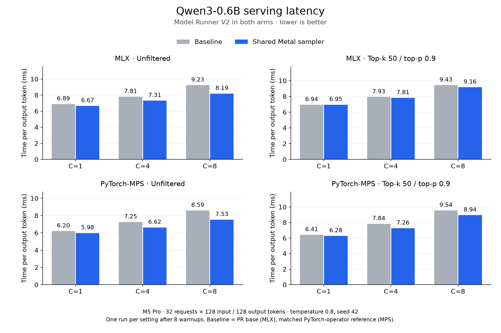
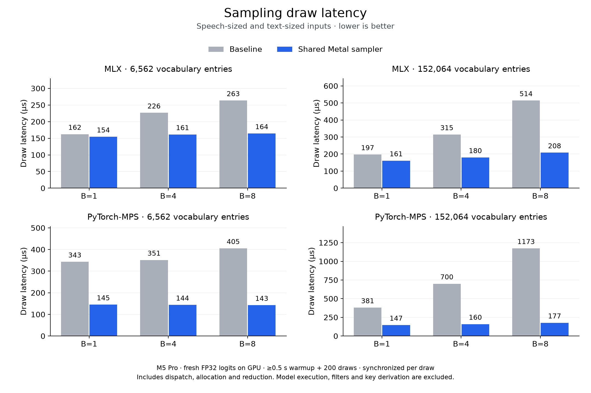

# Sampling benchmarks for vllm-metal #1234

Measured November 3, 2026 on an Apple M5 Pro with 64 GiB. PyTorch 2.16.0.dev20261013, MLX 0.32.4 and vLLM 0.32.0+cpu. MPS CPU fallback was disabled.

The candidate is [95da4bb3](https://github.com/vllm-project/vllm-metal/commit/95da4bb32b1146c3521ce7f2b61016487cc8bbd6).

- Serving uses Qwen3-0.6B FP16 with Model Runner V2 in both arms, 32 requests of 128 input and 128 output tokens, concurrency 1/4/8 and temperature 0.8. Each setting ran once after eight warmup requests. All 960 measured requests completed.
- The MLX baseline is [the PR base](https://github.com/vllm-project/vllm-metal/commit/a44be48731005932a24dd30b55c21e992dc90b9a). The MPS baseline uses the candidate checkout with only the sampler replaced by the frozen PyTorch-operator reference below. The PR base supports greedy MPS decoding only.
- The draw benchmark uses GPU-resident, temperature-scaled FP32 logits, at least ten warmups spanning at least 0.5 seconds, and one window of 200 fresh draws per shape. Each draw is synchronized. Timings include dispatch, allocation and final token reduction. Model execution, filters and key derivation are outside the timed region. All 5,200 measured MPS token IDs matched the operator reference. MLX uses a different RNG stream from its baseline.
- The small vocabulary measures the shared primitive on speech-sized inputs. Omni serving currently uses the MPS backend.

[Serving measurements](end-to-end.json) · [Draw measurements](microbenchmark.json) · [Serving harness](run_benchmarks.py) · [Draw harness](micro_benchmark.py) · [PyTorch reference](pytorch_reference.py) · [Plotting](plot_results.py)

The serving harness records the exact checkout, patch and CLI arguments per run. Its paths select the local benchmark checkouts. The draw harness accepts `--backend mlx|mps`, `--variant baseline|shared` and `--output result.json`. Use `PYTORCH_ENABLE_MPS_FALLBACK=0`.
